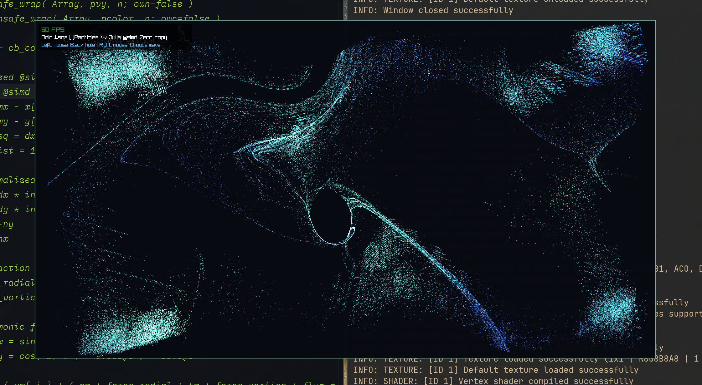

# Simple particle system - half Odin half Julia
Two languages dancing together in a fast way.

## Description
A main Raylib program in Odin that calls Julia to update forces on the particle that calls Odin to calculate the colors of them, and they both dance quite nicelly at 60 Frames per second.

This is a simple 250 000 particles high performance single thread SIMD example of bindings and callbacks between Odin and Julia.

## Screen shoot

## To compile and run use
Odin 2026_09  
Julia 1.13

## License
MIT Open Source

## Have fun
Best regards,  
Joao Carvalho
